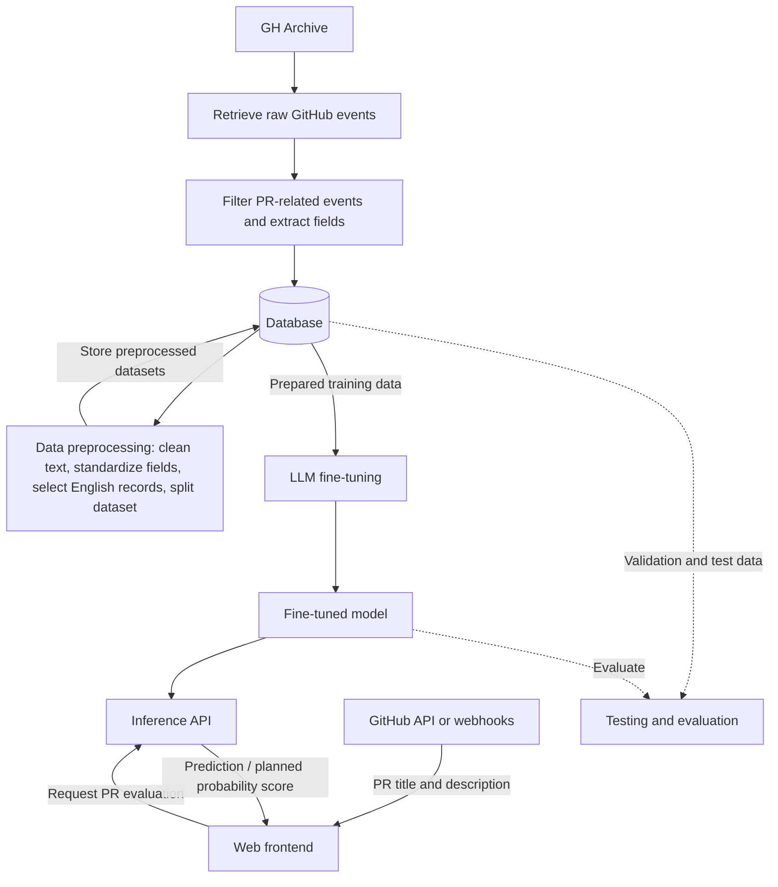

# Pull Request Analysis with GitHub Archive and Language Models

## Project Overview

This project explores the analysis of GitHub pull requests (PRs) using historical GH Archive data and language models. The planned workflow collects public GitHub events related to pull requests, extracts relevant information, prepares and stores a structured dataset, and uses it to fine-tune and evaluate a pretrained language model.

A web-based interface is planned for repository maintainers. PR information, including the title and description, is intended to be retrieved through the GitHub API or webhooks rather than entered manually. The maintainer can view the PR information in the frontend and request a model-generated prediction.

The diagram and workflow below describe the **proposed technical architecture**. Individual components, model choices, data formats, and deployment details may change during implementation.

## Project Objectives

- Collect and filter relevant **pull-request-related GitHub events** from GH Archive.
- Associate PR text (title and description) with an observed outcome, where available.
- Store filtered records and preprocessed data in a database for downstream processing.
- Prepare consistent, English-language text inputs for modeling.
- Fine-tune a pretrained large language model (LLM) on the preprocessed data.
- Evaluate the resulting model on separate validation and test data.
- Provide a frontend in which maintainers can view PR information retrieved via the GitHub API or webhooks and request predictions.
- Containerize the project's modules using Docker to support integration and a clean project structure.

## Technical Workflow

### 1. Data Acquisition — GH Archive

The starting point is **GH Archive**, which provides historical records of public GitHub activity. Raw event data is retrieved for the selected observation period. This source is used to identify events related to pull requests and, potentially, their review activity.

### 2. Event Filtering and Field Extraction

The raw data is filtered to retain relevant PR-related events and remove unnecessary fields. The initial feature set shown in the project sketch includes:

- **PR title** — a concise summary of the proposed change.
- **PR description** — the text explaining the proposed change.
- **PR status/outcome** — whether the pull request was merged or closed without merging, when this can be established.

**Labeling assumption:** For this project, PRs closed without a merge are treated as lower-quality examples, regardless of whether the maintainer or the contributor closed them. This is a project-specific modeling assumption, not proof of the reason a PR was closed. GH Archive does not provide a dedicated `rejected` action. Review feedback such as `changes_requested` is distinct from a final PR outcome. Available fields and payload structures can differ across periods, so extraction rules must be checked against the actual archive records.

### 3. Data Storage

The extracted and filtered records are stored in a **database**. The **preprocessed data is also written back to the database** so that large datasets can be managed and accessed by subsequent stages without relying solely on intermediate local files. The database technology and final schema are still to be selected.

### 4. Data Preprocessing

Records are prepared for use as model inputs. The planned preprocessing tasks include:

1. Clean and normalize textual data.
2. Remove irrelevant or unusable records.
3. Standardize the extracted information into a consistent format, accounting for differences between individual PR templates and descriptions.
4. Restrict the training text to **English-language** entries, as currently planned.
5. Split the dataset into **training, validation, and test sets**.
6. Store the resulting preprocessed datasets in the database for fine-tuning and evaluation.

**This stage prepares data; it does not train a model.**

### 5. LLM Fine-Tuning

This is the **model training stage**. An existing pretrained **large language model (LLM)** is adapted using the prepared training data; the model is **not trained from scratch**. Planned considerations include:

- Selecting a suitable pretrained base model.
- Deciding which model parameters or layers to adapt, including whether to modify an output layer.
- Establishing the required GPU resources.
- Saving the fine-tuned model for inference.

The specific model, compute configuration, and fine-tuning method remain open design decisions.

### 6. Frontend and Inference

The planned frontend allows a repository maintainer to evaluate PRs through the fine-tuned model:

1. PR information, including the **title and description**, is retrieved through the **GitHub API or webhooks**.
2. The maintainer can view this information in the frontend.
3. The maintainer triggers an evaluation of the PR.
4. The frontend requests inference through an API and displays the model's prediction.

A **probability score** is currently planned as part of the model output, although the exact presentation may change during development.

**Optional extension, if time permits:** GitHub login could enable maintainers to see a list of open PRs in a repository, select a PR, review its title and description, and request a model evaluation directly from that view.

## Testing and Evaluation

**Training, validation, and test data are separated during preprocessing**. Model performance will be evaluated using data not used for fine-tuning; the final metrics and baselines will be defined during implementation.

Care is needed to avoid data leakage: events and updates associated with the same pull request should not be split across datasets in a way that reveals the target outcome.

## Docker Containerization

The individual **project modules are planned to be developed and delivered as Docker containers**. Containerization is intended to make the components easier to integrate, keep their responsibilities separated, and support a clean project structure.

This applies to the modules described in the workflow, including data acquisition and filtering, data preprocessing, LLM fine-tuning/inference, and the frontend, with database integration considered as part of the overall setup. The exact container boundaries, configuration, and orchestration approach have not yet been finalized.

## Branching & Contribution Guidelines

To maintain a clean repository structure and ensure smooth collaboration, the following Git conventions should be followed.

### Branch Naming

Branches should use descriptive names with predefined prefixes:

- `feature/<feature-name>` – For implementing new features.
- `bugfix/<fix-name>` – For fixing existing issues.

### Commit Messages

A consistent commit message format is recommended but not required:

- `feature(scope): <description>`
- `bugfix(scope): <description>`

Suggested scopes include `database`, `frontend`, and `backend`.

### Merging Workflow

- Changes should be implemented on dedicated feature or bugfix branches.
- Direct pushes to `main` should be avoided whenever possible.
- Completed changes should be merged into `main` through a **Pull Request (PR)**.
- PRs should be reviewed before merging whenever possible.

## Current Design Decisions to Finalize

- Observation period and coverage of GH Archive records.
- Whether review events will be included as additional signals.
- Whether additional user-related data will be included, such as account age, commit history, or stars.
- Database system and schema.
- Text preprocessing rules and procedures.
- Base model, fine-tuning method, and compute environment.
- Evaluation metrics and training/validation/test split.
- API framework, frontend technology, and deployment.
- Docker container boundaries and integration approach.

## Project Status

**Architecture / planning stage.** This README documents the intended workflow based on the project sketch and review notes; it does not claim that every component has already been implemented.
